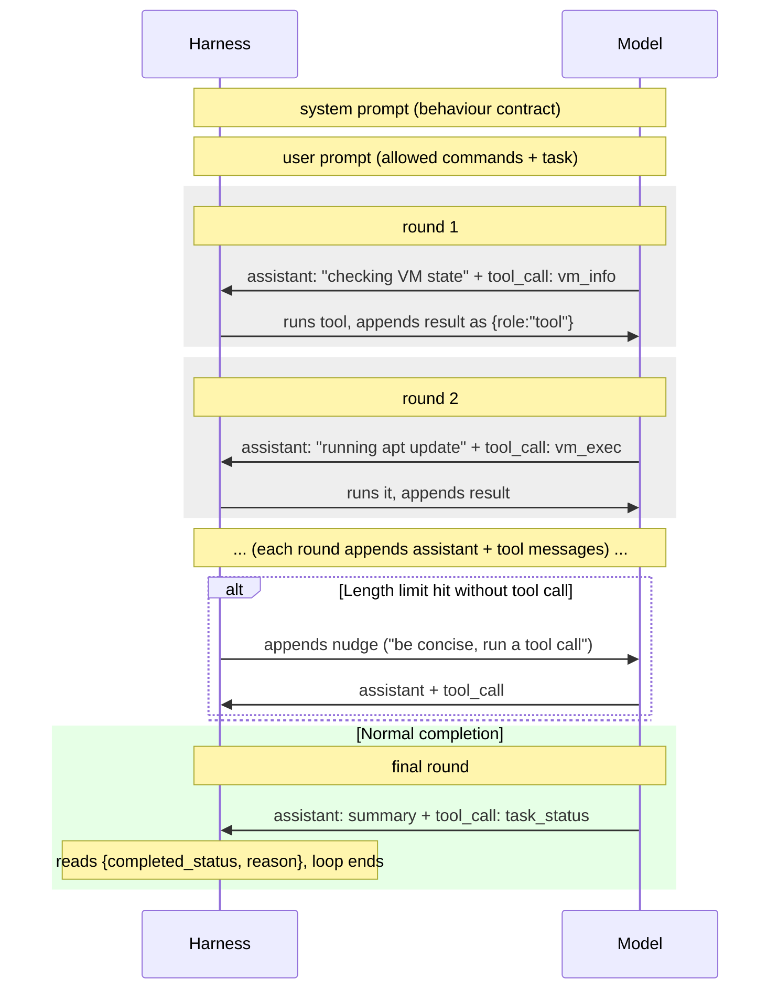

# MPHarness tool calling

`mph` exposes a deliberately small toolset: `vm_exec` and `vm_info` at its core, `task_status` for reporting the final outcome, plus `output_search` and `output_read` when output capture is enabled (`output.enabled`, which defaults to `true`). There are several reasons for the small core:
- less tool call specs = more space in context window.
- The agent doesn't manage the VM's lifecycle at all. The VM is guaranteed to be up and running by the time the agent needs to work, so the agent only ever inspects it and runs commands.
- Having explicit tool calls for VM lifecycle tend to confuse smaller models (i.e forgetting to check if a VM is running before executing commands) which results in extra computation, which is wasteful.

## The contract
| Tool | What the model must supply | What it returns |
|------|----------------------------|-----------------|
| `vm_exec` | `command` (string), optional `capture` (bool) | combined stdout/stderr, or a capture handle (`output_id`, path, line counts) when `capture: true` |
| `vm_info` | n/a | raw LXD instance JSON (`GetInstanceFull`) |
| `task_status` | `status` (`Completed`, `Failed`, `Error`), `reason` (string) | nothing to the model; the harness reads `{completed_status, reason}` and ends the run |
| `output_search` | `output_id`, `pattern` | matching line numbers in a captured output |
| `output_read` | `output_id`, optional `offset`/`limit` | a slice of a captured output |

For `vm_exec`, the `command` string can be several commands at once (such as `cat /proc/uptime | grep ...`), the input command is parsed into a shell AST and each command is validated against the allow list.

`vm_info` takes no arguments. It returns the raw JSON instance record from the LXD daemon (`GetInstanceFull`) for the configured VM, which includes the instance state, config limits (CPU and memory), image properties, addresses, memory usage, and disk usage. Because the harness guarantees the VM is already running, `vm_info` is for *orientation*, for example, determining correct parameters for some command given the VM specs.

### Reporting the outcome

`task_status` is the terminal tool. The agent calls it exactly once as its last action, after the work is finished or execution halts. The harness consumes the call as a struct (`completed_status`, `reason`) instead of returning a tool result to the model, so the run ends there and no further model turn follows. The assistant content sent with that call is the final summary surfaced to the user.

| Status | Meaning |
|--------|---------|
| `Completed` | All requested tasks were accomplished. |
| `Failed` | The task was understood but the requested outcome was not achieved. |
| `Error` | An execution problem prevented completing or evaluating the task. |

`reason` is required for every status and is free-form: a concise, factual explanation written by the agent. If a required command is denied, the agent reports `Error` rather than working around the restriction.

A command that ran is not automatically a success. The system prompt tells the agent to inspect each tool result's status, output, stderr, and error text, and to report `Failed` or `Error` instead of `Completed` when a command failed or its output shows an error.

The system prompt also states that the agent operates inside the VM and must run every requested command with `vm_exec`, subject to the configured allowlist. It must not ask the user to run commands, refuse before trying, or claim a command is not allowed without a tool result. If the task predicts a failure, the agent still runs the command and reports what happened.

### How the tools are described to the model

The model needs a description of each tool's *shape*. `mph` builds an OpenAI-style JSON-schema document for each one: name, description, and parameters, and sends these as the `tools` field of the chat request (`buildToolDocuments` in `internal/agent`). For `vm_exec` that document looks roughly like:

```json
{
  "type": "function",
  "function": {
    "name": "vm_exec",
    "description": "Run a command inside the configured VM and return combined stdout/stderr...",
    "parameters": {
      "type": "object",
      "properties": {
        "command": { "type": "string" }
      },
      "required": ["command"]
    }
  }
}
```


`vm_info` gets the same shape with no parameters at all (`"parameters": { "type": "object", "properties": {} }`), so the model can call it at any point for a fresh read of the VM state.


## The loop

Because model calls are stateless text generation, the harness keeps the whole state in the conversation:



The loop normally ends when the model calls `task_status`; the harness reads the outcome struct and does not reply. A message **without** tool calls first gets one nudge to call `task_status`; if the next turn also has no tool call, the loop ends without an outcome. `max_iterations` still bounds the run. In every case the harness prints the collected command output.

**Length-limit recovery.** If the model's reply exhausts its token budget without a tool call (finish_reason = "length"), the harness appends a nudge ("Your previous response hit the token limit without making a tool call. Please be concise and try again and run a tool call if necessary") and retries rather than dying.

## Keeping the loop stable

Two details keep the loop stable:

- **Status nudge.** If the model finishes with text but no tool call, the harness appends the summary plus a user nudge that tells it to call `task_status`, then continues for one more turn.
- **Length-limit recovery.** If the model's reply exhausts its token budget without a tool call, the harness appends a nudge ("be concise and run a tool call") and retries rather than dying.

## What the model sees when a tool runs

Tool results are returned to the model as JSON and are status-tagged so the model can react. `vm_exec` returns the combined output:

```json
{ "status": "SUCCESS", "data": { "output": "<combined stdout/stderr>" } }
```

and `vm_info` returns the raw LXD instance JSON:

```json
{ "status": "SUCCESS", "data": { "result": "<raw LXD instance JSON>" } }
```

or, on a failure (including a denied command):

```json
{ "status": "FAILED", "data": { "error": "..." } }
```

`task_status` is the exception: the harness intercepts the call, records the outcome, and ends the run, so the model receives no tool result at all.

The system prompt makes denial a hard stop: if a tool is denied, the agent must report and finish rather than try to work around the restriction. This is to prevent unintended behavior.

## Related

- [Configuring the LLM](../how-to/configure_llm.md)
- [Managing the VM lifecycle](../how-to/manage_vm_lifecycle.md)
- [Restricting commands](../how-to/restrict_commands.md)
- [Software architecture](../reference/arch.md)
