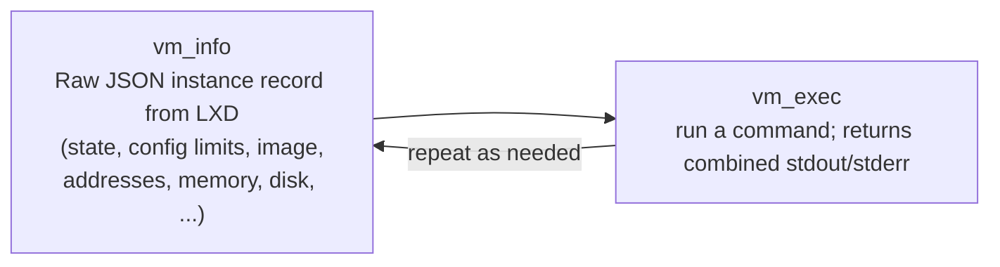

# Managing the VM lifecycle

The harness manages the VM lifecycle **outside** the agent loop. The agent's core tools are `vm_exec` and `vm_info` (plus `output_search`/`output_read` for captured output; see [How tool calling works](../explaination/tool_calling.md)). It cannot create, start, stop, or delete the VM.

## Harness VM lifecycle

```mermaid
flowchart TD
    START([Start]) --> CHECK{VM exists?}
    CHECK -->|No| LAUNCH[Launch VM with configured spec]
    CHECK -->|Yes| PROMPT{User confirms<br/>reuse? (-i skips)}
    PROMPT -->|No| EXIT[Exit]
    PROMPT -->|Yes| AGENT
    LAUNCH --> AGENT[Run agent loop]
    AGENT --> DELETE{Keep VM? (-k flag)}
    DELETE -->|No| DEL[Delete VM]
    DELETE -->|Yes| KEEP[Keep VM]
    DEL --> END([Done])
    KEEP --> END
```

## The agent's tool cycle

Inside the agent loop, the core tools work together:



- `vm_info` returns the raw JSON instance record from the LXD daemon for the configured VM, wrapped in the standard tool-result envelope (`{"status":"SUCCESS","data":{"result":"<raw JSON>"}}`). It carries the instance state, config limits, image properties, addresses, memory, and disk usage. Use it for orientation before or between commands.
- `vm_exec` runs a command and returns its combined stdout/stderr.

Your prompt only needs to describe the task. There is nothing to write about creating, starting, stopping, or deleting the VM, because the agent cannot do any of those.

The harness will prompt for confirmation to continue if a VM with the same name already exists (unless you pass the `-i` flag to ignore and reuse it). A stopped instance is started and awaited before the run. An existing instance that is not a virtual machine is rejected with a clear error.
If you don't pass the `-k` flag, the harness deletes the VM after the agent run finishes, whether the agent reports `Completed`, `Failed`, or `Error`. If the harness itself fails (for example a timeout or an LXD error), it exits before the delete step, leaving the VM running for inspection.

- [How tool calling works](../explaination/tool_calling.md)
- [Software architecture](../reference/arch.md)
- [Configuring the VM](configure_vm.md)
